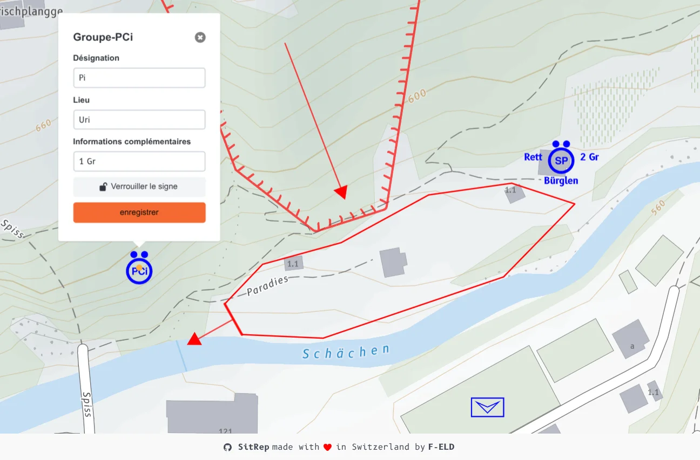

Plus de clarté, plus de rapidité, plus d'impact : ces nouveautés font passer votre carte de renseignements au niveau supérieur.

Un grand merci à toutes les organisations de toute la Suisse qui, grâce à leurs retours du terrain, contribuent activement à faire évoluer sitrep. Grâce à ces retours précieux, nous pouvons présenter dans la dernière version plusieurs améliorations importantes du module cartographique.

## Nouvelles fonctionnalités

### Signes conventionnels et libellés OFPP multilingues

Les signes conventionnels et désignations OFPP s'adaptent automatiquement au français, à l'allemand et à l'italien. Tous les signes conventionnels OFPP actuellement disponibles sont désormais aussi disponibles dans sitrep. Exemples : Place pour véhicules, Organe de conduite cantonal, ainsi que les libellés des formations et partenaires comme la police et les sapeurs-pompiers.

### Nouvelles zones et représentation étendue

Nouveaux types de zones : zone inondée avec direction du flux, ainsi que zones contaminées (zone biologiquement contaminée, zone chimiquement contaminée sous forme liquide ou gazeuse, zone radioactive). S'y ajoutent la représentation de la direction pour le glissement de terrain et la zone de décombre pour des représentations de situation plus précises.

### Description intelligente des signes conventionnels

Les champs d'édition s'adaptent automatiquement au signe conventionnel sélectionné. Les formations et véhicules reçoivent trois champs de description :

- **Désignation :** service ou formation comme sauv, appui, assist, REDOG
- **Lieu :** numérotation ou localisation
- **Informations complémentaires :** nombre de sections ou groupes comme 2 sct, 3 gr

## Résultat

La carte de renseignements devient plus intuitive et offre plus de possibilités pour des représentations de situation plus précises.

## Et ensuite

Nous travaillons actuellement à finaliser le flux de triage amélioré, qui permettra finalement de relier le journal avec les messages et les éléments de la carte. D'autres informations suivront bientôt.

## Essayer et déployer

Testez sitrep dès maintenant sur [demo.sitrep.ch](https://demo.sitrep.ch) et partagez vos retours ainsi que vos suggestions d'amélioration dans les [GitHub Discussions](https://github.com/f-eld-ch/sitrep/discussions/1764) ou par e-mail à [info@sitrep.ch](mailto:info@sitrep.ch).

Vous souhaitez déployer sitrep dans votre organisation ? Nous vous accompagnons pour l'auto-hébergement ou l'exploitation comme service, ainsi que pour l'onboarding. Plus d'informations sous [Mettre sitrep en œuvre]().
