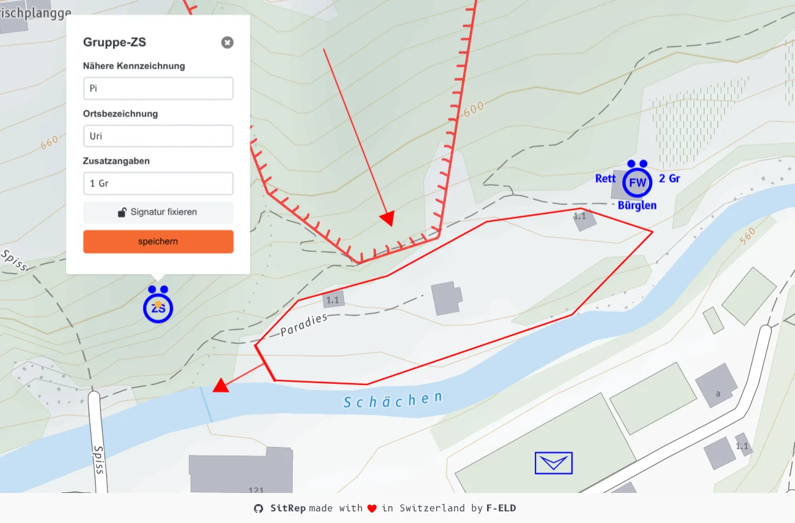

Mehr Klarheit, mehr Tempo, mehr Wirkung: Diese Neuerungen bringen Ihre digitale Nachrichtenkarte auf das nächste Level.

Ein herzliches Dankeschön an alle Organisationen aus der ganzen Schweiz, die mit ihrem praxisnahen Feedback sitrep aktiv mitgestalten. Dank dem wertvollen Feedback können wir im neuesten Release diverse wichtige Verbesserungen im Kartenmodul präsentieren.

## Neue Funktionen

### Mehrsprachige BABS-Signaturen und Beschriftungen

BABS-Signaturen und Bezeichnungen passen sich automatisch an Deutsch, Französisch und Italienisch an. Alle aktuell verfügbaren Signaturen des BABS sind nun auch auf sitrep verfügbar. Beispiele: Fahrzeugplatz, Kantonales Führungsorgan sowie Formations- und Partner-Beschriftungen wie Polizei und Feuerwehr werden sprachabhängig korrekt dargestellt.

### Neue Zonen und erweiterte Darstellung

Neue Zonentypen: Überschwemmtes Gebiet sowie verseuchte Gebiete (Biologisch verseuchtes Gebiet, Chemievergiftete Zone flüssig oder gasförmig, Radioaktives Gebiet). Dazu kommen die Richtungsdarstellung beim Rutschgebiet und die Linie Trümmerbereich für präzisere Lagedarstellungen.

### Intelligente Beschriftung der Signaturen

Bearbeitungsfelder passen sich automatisch an das ausgewählte Signatur an. Formationen und Fahrzeuge erhalten drei Beschriftungsfelder:

- **Nähere Kennzeichnung:** Dienste oder Formation wie Lösch, Ustü, Rttg, OD
- **Ortsbezeichnung:** Nummerierung oder Ort
- **Zusatzangaben:** Anzahl Züge oder Gruppen wie 2 Z, 3 Gr

## Ergebnis

Die Nachrichtenkarte wird intuitiver und bietet mehr Möglichkeiten für genauere Lagedarstellungen.

## Wie geht es weiter

Aktuell arbeiten wir daran, den verbesserten Triagefluss fertigzustellen. Damit wird es schliesslich möglich, das Journal mit Meldungen und Kartenelemente miteinander zu verknüpfen. Bald folgen auch dazu nähere Infos.

## Ausprobieren und einsetzen

Testen Sie sitrep jetzt auf [demo.sitrep.ch](https://demo.sitrep.ch) und teilen Sie uns Ihr Feedback sowie Ihre Verbesserungswünsche in den [GitHub Discussions](https://github.com/f-eld-ch/sitrep/discussions/1764) oder per E-Mail an [info@sitrep.ch](mailto:info@sitrep.ch) mit.

Möchten Sie sitrep in Ihrer Organisation einsetzen? Wir unterstützen Sie beim Selber-Betreiben oder beim Betrieb als Service und begleiten Ihr Onboarding. Mehr dazu unter [sitrep einsetzen]().
