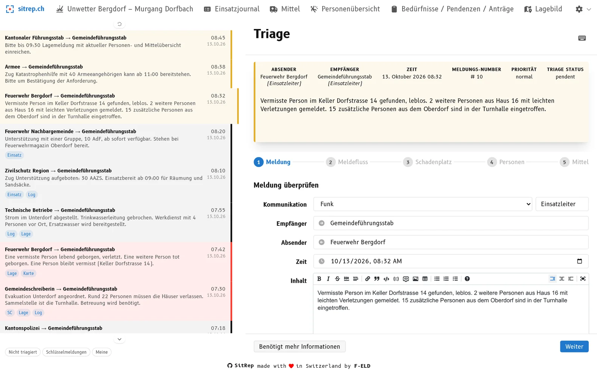
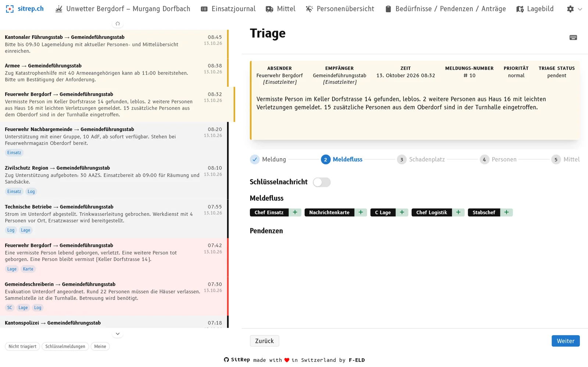
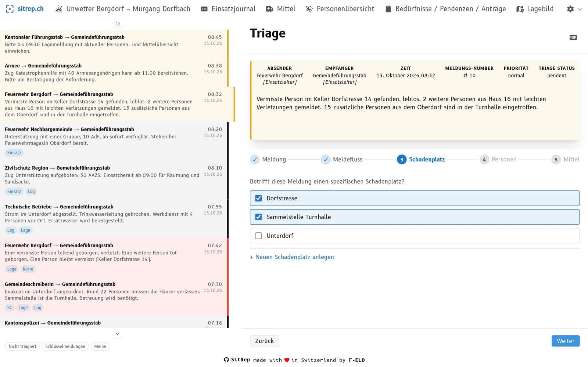
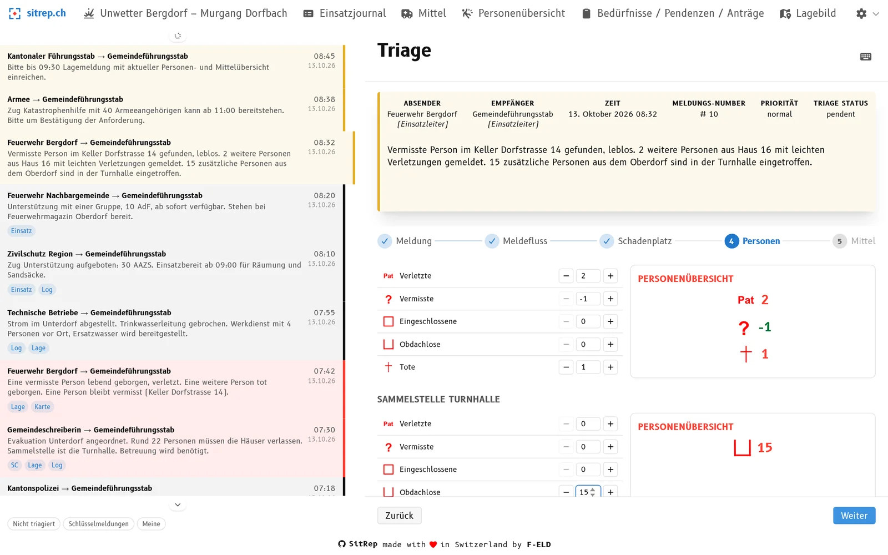
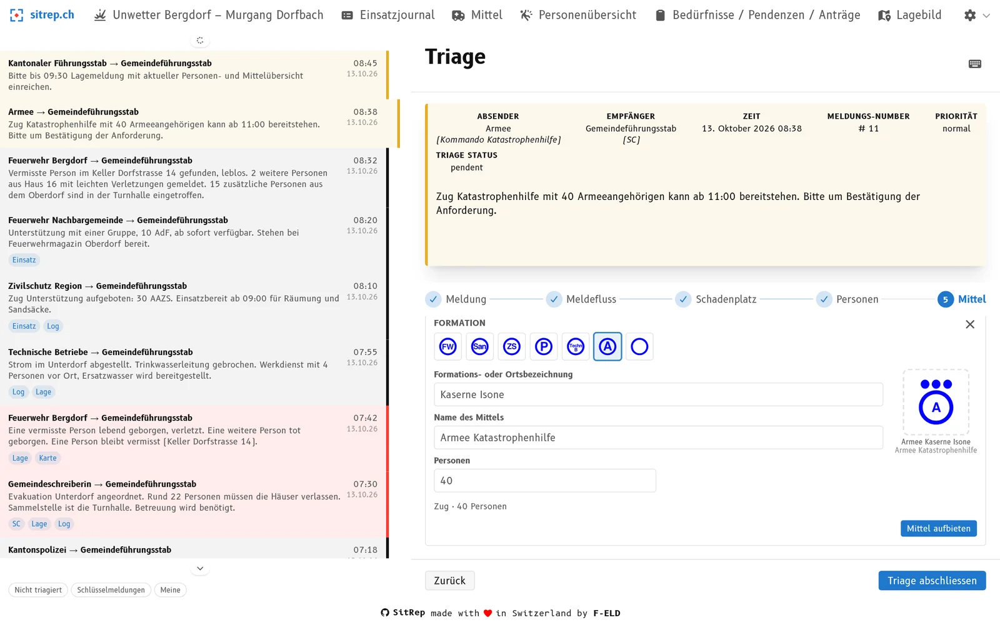
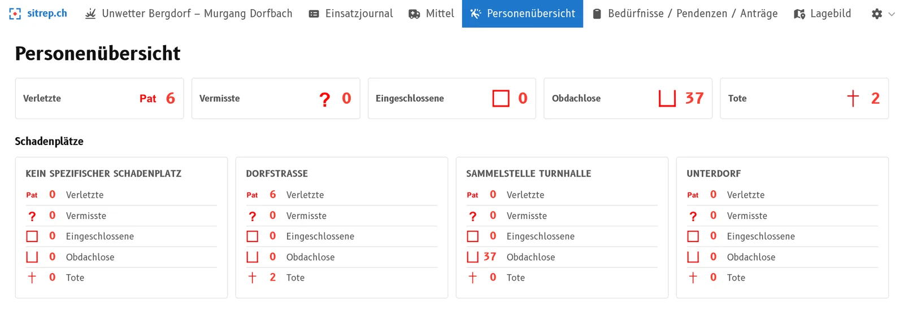
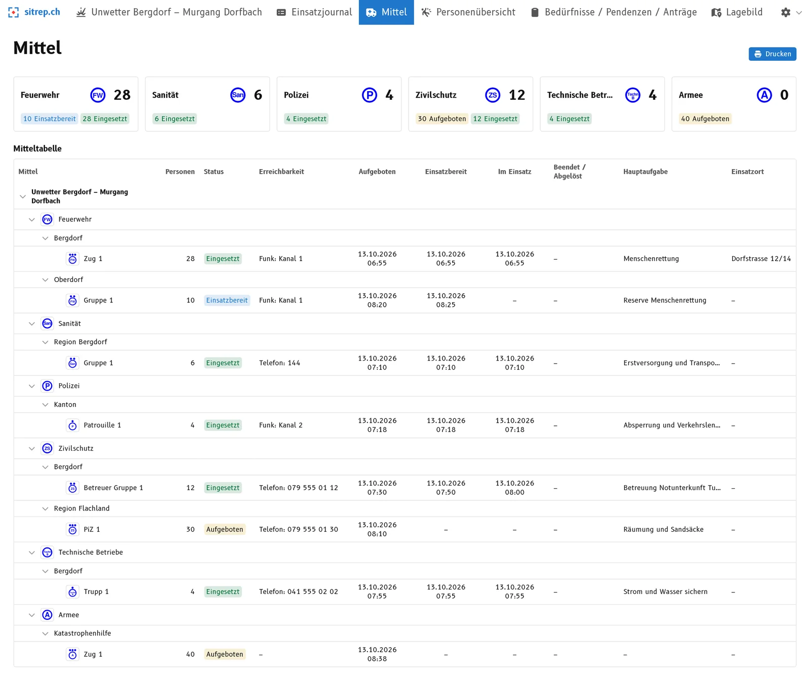
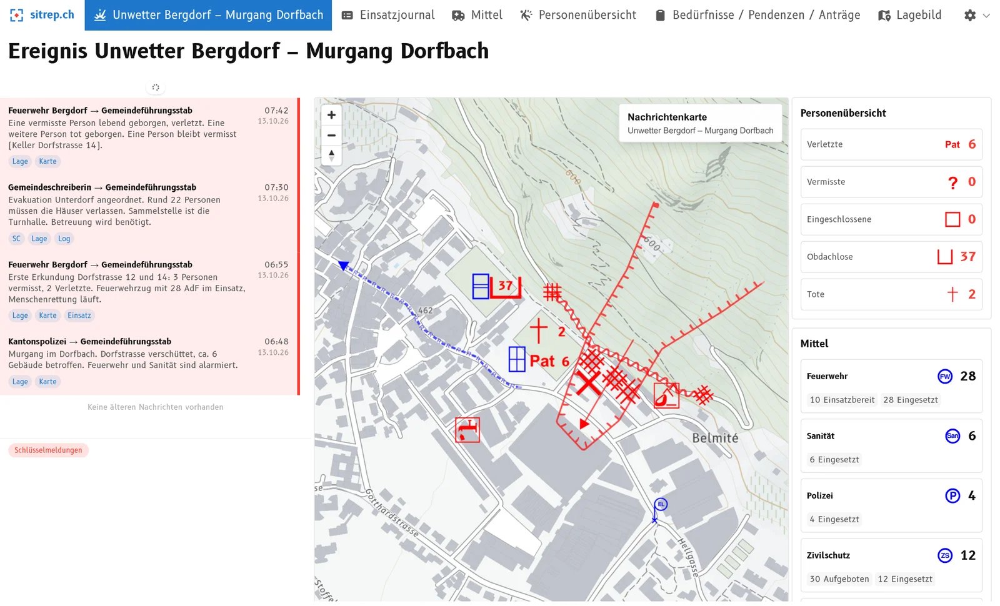

**08:45 Uhr im Lagezentrum.** Der kantonale Führungsstab meldet sich: *«Bitte bis 09:30 Lagemeldung mit aktueller Personen- und Mittelübersicht einreichen.»*

Jetzt zählt jede Minute. Der Stab braucht Antworten:

- Wie viele Verletzte haben wir?
- Wie viele Vermisste sind noch offen, und wie viele wurden gefunden?
- Welche Einsatzmittel sind aufgeboten, welche schon im Einsatz? Mit wie vielen Personen?

Die Antworten stecken irgendwo in den Meldungen der letzten Stunden. Jemand blättert im Einsatzjournal, jemand anderes zählt auf einem Zettel zusammen. Das kostet Zeit, und es schleichen sich Fehler ein: eine Meldung doppelt gezählt, eine vergessen, ein Zwischenstand veraltet.

Dabei wurde jede dieser Meldungen schon einmal gelesen und beurteilt: in der Triage. Genau dort setzt die neue Triage-Ansicht in sitrep an, der Software für die Führungsunterstützung. Wer eine Meldung triagiert, führt Personen- und Mittelübersicht gleich mit. Wenn die Anfrage kommt, lässt sich die Antwort vom Bildschirm ablesen.

In diesem Artikel zeigen wir, wie das funktioniert und warum die Triage der richtige Ort dafür ist. Sie erfahren auch, warum das keinen Zusatzaufwand bedeutet.

## Was der Führungsbehelf dazu sagt

Der Führungsbehelf «Handbuch Führungsunterstützung – Lage» legt den Weg der Meldung klar fest:

- Die **Triage** ist die Stelle, an der Meldungen in den Lageverarbeitungszyklus eintreten. Dort werden alle Meldungen gesichtet, priorisiert und an die richtigen Stellen weitergeleitet. Beim Triagieren wird auch festgelegt, welche Inhalte in welchen Produkten erfasst werden.
- Die **Mittelübersicht** gehört zu den Standardprodukten im Sachbereich Lage. Sie ist der tabellarische Überblick über alle Einsatzmittel: auf Pikett gestellt, aufgeboten, einsatzbereit, eingesetzt oder zur Ablösung vorgesehen.
- Auf der **Lagewand** gehören Fakten-Flash, Nachrichtenkarte und Mittelübersicht zusammen.

Der Behelf sagt also: Die Triage entscheidet, **wohin** eine Information fliesst. sitrep geht den logischen nächsten Schritt. Die Information landet nicht nur beim richtigen Ressort, sondern gleich in der richtigen Übersicht.

## Warum das in der Triage passieren muss

Man könnte die Übersichten auch «bei Bedarf» nachführen, zum Beispiel jede Stunde oder vor dem Rapport. Das ist die klassische Methode. Dagegen sprechen vier Gründe.

**1. Die Information ist am frischesten, wenn die Meldung eintrifft.**
Die Person in der Triage hat die Meldung vor sich. Sie weiss, was gemeint ist, und kann bei Unklarheiten sofort nachfragen. Eine Stunde später muss jemand die Meldung erneut lesen und deuten.

**2. Nachzählen ist fehleranfällig.**
Wer alle Meldungen periodisch zusammenzählt, muss jede Meldung nochmals anfassen. Das ist die perfekte Gelegenheit für Doppelzählungen und Vergessenes. Wer jede Änderung genau einmal erfasst, zählt automatisch richtig.

**3. Alle arbeiten mit denselben Zahlen.**
Der Behelf verlangt, dass sich Textprodukte und Grafikprodukte nicht widersprechen. Das geht nur, wenn es eine gemeinsame Quelle gibt. In sitrep sind Dashboard, Personenübersicht und Mittelübersicht immer aus denselben Triage-Eingaben berechnet.

**4. Jede Zahl hat eine Herkunft.**
Wenn der Stab fragt «Woher kommen die 37 Obdachlosen?», lässt sich das zur Meldung zurückverfolgen. Bei einer nachträglich geführten Tabelle ist das oft nicht mehr möglich.

Kurz: **Die Information wird einmal erfasst, am richtigen Ort im Prozess, und steht danach in allen Übersichten bereit.**

## Die neue Triage in fünf Schritten

Bisher wurden Meldungen mit Schaltflächen direkt bei der Meldung triagiert. Die neue Triage-Ansicht ist eine eigene Ansicht und führt durch fünf Schritte. Das Beispiel ist ein fiktives Ereignis: ein Murgang im Dorf «Bergdorf» nach einem Unwetter.

### 1. Meldung prüfen

Absender, Empfänger, Zeit und Inhalt werden kontrolliert und bei Bedarf korrigiert. Die Meldung steht oben immer sichtbar, auch in den weiteren Schritten.

### 2. Meldefluss festlegen

Hier wird entschieden, wer die Meldung erhalten muss: Chef Einsatz, Nachrichtenkarte, C Lage, Chef Logistik, Stabschef. Wichtige Meldungen lassen sich als **Schlüsselnachricht** markieren.

### 3. Schadenplatz wählen

Betrifft die Meldung einen bestimmten Schadenplatz? Falls ja, wird er hier gewählt, oder direkt ein neuer angelegt. Alle Zahlen im nächsten Schritt werden diesem Schadenplatz zugeordnet.

### 4. Personen erfassen

Hier werden die Personenzahlen erfasst, in den fünf Kategorien Verletzte, Vermisste, Eingeschlossene, Obdachlose und Tote.

Wichtig: Man erfasst nur das, **was die Meldung Neues sagt**. Wenn eine vermisste Person gefunden wird, steht bei Vermissten «−1» und bei Verletzten oder Toten «+1». sitrep rechnet die Gesamtzahl selbst nach und verhindert, dass ein Wert unter null fällt. Rechts ist sofort die Wirkung der Eingabe zu sehen.

### 5. Mittel aufbieten und disponieren

Meldungen betreffen oft Einsatzmittel. Hier wird festgehalten, was mit ihnen passiert ist. Jede Änderung wird mit der **Zeit der Meldung** in der Mitteltabelle festgehalten. Ein Einsatzmittel durchläuft dabei diese Stationen:

**Aufgeboten → Einsatzbereit → Eingesetzt → Abgelöst**

Die vier wichtigsten Aktionen:

- **Aufbieten:** Ein neues Einsatzmittel wird mit Formation, Name, Standort und Personenzahl erfasst. sitrep schlägt die passende Grösse (Trupp, Gruppe, Zug) anhand der Personenzahl vor.
- **Einsatzbereit melden:** Das Mittel ist eingetroffen oder bereit.
- **Disponieren und einsetzen:** Das Mittel erhält Auftrag (Hauptaufgabe) und Einsatzort und wird eingesetzt. Beides ist Pflicht, damit die Mitteltabelle nie ein Mittel im Einsatz ohne Auftrag zeigt.
- **Ablösen:** Ein anderes Mittel übernimmt. Auftrag und Einsatzort gehen automatisch an die Ablösung. Das abgelöste Mittel bleibt mit seiner Einsatzgeschichte in der Übersicht.

Weitere Aktionen für den Alltag im Einsatz:

- **Umdisponieren:** Hauptaufgabe, Einsatzort oder Schadenplatz eines Mittels werden angepasst.
- **Einsatz abgeschlossen:** Das Mittel kommt aus dem Einsatz zurück und ist wieder einsatzbereit.
- **Entlassen:** Das Mittel wird aus dem Einsatz entlassen und gilt als abgelöst.
- **Reaktivieren:** Bei mehrtägigen Einsätzen kommt ein abgelöstes Mittel am nächsten Tag wieder in den Dienst.
- **Erreichbarkeit pflegen:** Funkkanal oder Telefonnummer lassen sich anpassen.

Mit «Triage abschliessen» wird alles in einem Zug gespeichert.

## Kein Zusatzaufwand, sondern Teil des Prozesses

Digitale Lageverarbeitung darf kein Zusatzaufwand sein. Niemand soll Informationen, die die Führungsunterstützung ohnehin verarbeitet, ein zweites Mal in ein digitales Tool übertragen müssen. Sie muss ein fester Bestandteil des Verarbeitungsprozesses sein: Die Arbeit im Tool ist die Arbeit im Prozess.

Genau so ist die Triage-Ansicht aufgebaut. Sie führt durch die Schritte, die der Führungsbehelf für die Triage vorsieht: Meldung prüfen, Meldefluss festlegen, Schadenplatz zuordnen, Personen und Mittel erfassen. Was in der Triage entschieden wird, ist gleichzeitig der Eintrag in den Übersichten. Es gibt keine zweite Erfassung.

Das hilft einem Stab und der Führungsunterstützung auch unter Zeitdruck, sich an die richtigen Abläufe zu halten. In den Schritten 3 bis 5 muss nur etwas erfasst werden, wenn die Meldung einen Schadenplatz, Personen oder Einsatzmittel betrifft. Sonst geht es mit «Weiter» zügig durch.

## Das Ergebnis: Übersichten, die dem aktuellen Triagestand entsprechen

Zurück zum Beispiel aus der Einleitung: Der Kanton verlangt um 08:45 eine Lagemeldung mit Personen- und Mittelübersicht. Im Ereignis «Murgang in Bergdorf» sind die bisherigen Meldungen triagiert. Die Antwort an den Kanton ist darum keine Rechenaufgabe mehr: Die Informationen lassen sich jederzeit triageaktuell aus der Personenübersicht und der Mittelübersicht ablesen.

### Personenübersicht

Die Personenübersicht zeigt die Gesamtzahlen und die Aufteilung nach Schadenplätzen. Sie entspricht jederzeit dem aktuellen Triagestand, ohne dass jemand etwas zusammenzählen muss.

### Mittelübersicht

Die Mittelübersicht orientiert sich an der Mitteltabelle des Führungsbehelfs. Sie ist nach Formation gruppiert und zeigt zu jedem Mittel:

- Personenzahl und **Status** (aufgeboten, einsatzbereit, eingesetzt, abgelöst)
- **Erreichbarkeit** (Funkkanal oder Telefon)
- Die **Zeitpunkte** von Aufgebot, Einsatzbereitschaft, Einsatzbeginn und Ablösung
- **Hauptaufgabe** und Einsatzort

Wer die Übersicht für den Rapport oder die Lagewand braucht, druckt sie direkt aus.

Ein Detail, das uns wichtig war:

- In den Gesamtzahlen oben zählen **nur eingesetzte Mittel**. Aufgebotene und einsatzbereite Einsatzmittel werden separat ausgewiesen. So wird die Einsatzstärke nicht überschätzt. Im Beispiel: Die Armee ist aufgeboten (40 Personen), aber noch nicht im Einsatz, also steht dort in der Summe 0.

### Dashboard

Das Dashboard zeigt die aktuelle Lage auf einen Blick: die neuesten Meldungen, die Nachrichtenkarte, die Personenübersicht und die Mittel pro Formation. Es ist als **aktuelle Information für den Führungsstab** gedacht, zum Beispiel auf einem Beamer oder Fernseher im Führungsraum. Es aktualisiert sich laufend.

## Was das für Führungsstäbe bringt

- **Schneller:** Die Übersichten sind fertig, wenn die Frage kommt. Das Lagezentrum verliert keine Zeit mit Zusammenzählen.
- **Weniger Fehler:** Jede Änderung wird genau einmal erfasst, am Ort, wo die Meldung eintrifft. Doppelzählungen und vergessene Meldungen werden unwahrscheinlicher.
- **Nachvollziehbar:** Jede Zahl führt zurück zur Meldung, die sie ausgelöst hat.
- **Weniger Abstimmung:** Dashboard, Personenübersicht und Mittelübersicht zeigen dieselben Zahlen. Es gibt keine «Zettelwirtschaft» mit abweichenden Ständen.
- **Entlastung für Fachpersonen:** Die Funktion «Übersichten- und Listenführer» aus dem Führungsbehelf wird zu einem grossen Teil von der Triage mitgetragen. Das Personal kann sich stärker auf Beurteilung und Führung konzentrieren.

## Wie gut ist die Lageverarbeitung bei Ihnen?

Ob mit Zettel, Tabelle oder einem anderen Tool: Prüfen Sie es in Ihrer nächsten Stabsübung.

- Wie lange dauert es, bis die Personen- und Mittelübersicht auf dem aktuellen Stand ist?
- Wie oft müssen dieselben Informationen mehrfach erfasst werden?
- Hilft das Werkzeug der Führungsunterstützung, sich unter Zeitdruck an die richtigen Abläufe zu halten, oder steht es im Weg?

Wenn Ihnen diese Fragen bekannt vorkommen, probieren Sie sitrep direkt selbst aus: [demo.sitrep.ch](https://demo.sitrep.ch). Oder wir zeigen Ihnen gerne, wie sitrep damit umgeht, an einem Beispielereignis oder in Ihrer nächsten Übung. Schreiben Sie uns an [info@sitrep.ch](mailto:info@sitrep.ch).

Die neue Triage-Ansicht mit Personen- und Mittelübersicht testen aktuell ausgewählte Organisationen in einer **geschlossenen Vorabversion**. Wir rechnen damit, dass sie **Anfang November** für alle sitrep-Nutzenden verfügbar ist.
