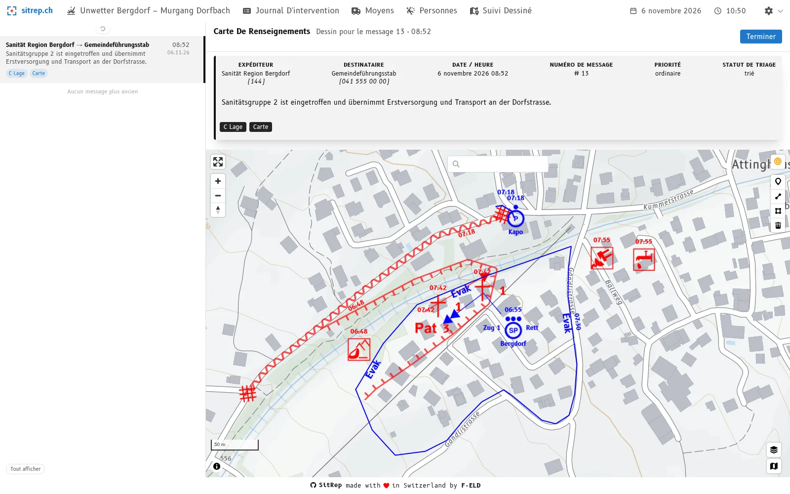
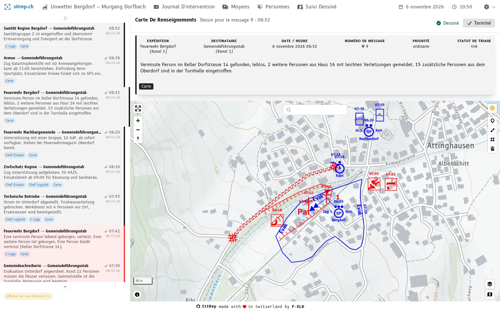
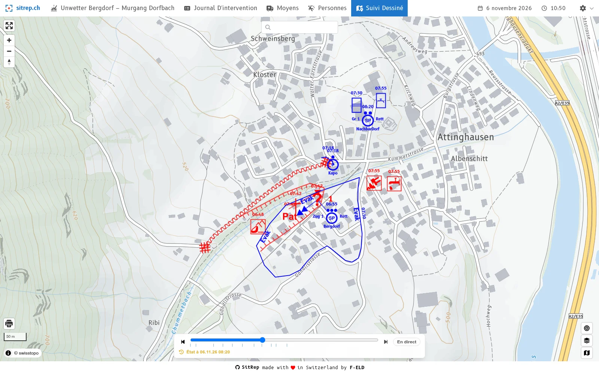

Entre deux rapports, l'état-major regarde surtout une chose : la carte sur la paroi. Celui qui passe devant veut savoir d'un coup d'œil ce qui est valable. Est-elle à jour des derniers messages, ou la situation d'il y a une heure y est-elle encore affichée ?

Tout état-major qui tient la carte à la main connaît le problème. Le manuel de l'OFPP « Aide-mémoire Intervention suivi de la situation » décrit la **carte de renseignements** comme un « instrument de travail permanent destiné à la saisie et à l’évaluation en continu du flux des messages importants ». Classiquement, un responsable de la carte de renseignements la tient sur un calque et le change de temps à autre pour qu'elle reste lisible. Il doit alors reporter sur le nouveau calque tout ce qui reste valable. Cela prend du temps et se fait souvent trop tard, voire pas du tout. La carte devient plus difficile à comprendre et à lire pour l'état-major.

C'est là qu'intervient la nouvelle **carte de renseignements** de [sitrep](), le logiciel open source de représentation électronique de la situation dans les états-majors de conduite. Elle est aussi le prolongement logique du [nouveau triage]().

## La carte analogique reste, la carte numérique s'y ajoute

sitrep ne veut pas remplacer la carte de renseignements analogique. La carte sur la paroi reste une solution de repli et un point de repère pour l'état-major, au rapport et entre les rapports. sitrep facilite son établissement et sa mise à jour.

Désormais, la carte est en plus à la disposition de tous les membres de l'état-major au format numérique : en l'ouvrant, on peut zoomer et lire le message qui correspond à chaque symbole. La carte de renseignements ne naît que de messages et reste ainsi traçable.

## La même logique que le triage

Le triage traite les messages un par un, le plus ancien d'abord, et détermine qui les reçoit. La carte de renseignements est construite de la même manière. Si vous attribuez un message à la carte de renseignements, il arrive à gauche dans la pile de messages, la liste des messages qui doivent encore être dessinés. Là, la règle est la même que pour le triage : choisir un message, le dessiner, le clore, puis vient le suivant. Qui connaît le triage sait donc aussi tenir la carte de renseignements. Aucune feuille de message n'a besoin d'être transmise au responsable de la carte.

## Ce que vous y gagnez

- **Le report devient plus simple.** La liste montre ce qui doit encore aller sur la carte. Ce qui est déjà dessiné au format numérique, vous le reportez sur la carte analogique, au lieu de le chercher d'abord dans le journal. Cela fait gagner du temps, et le report se fait plus souvent à temps.
- **Un double contrôle.** Les erreurs se corrigent rapidement au format numérique, avant d'être dessinées à la main. Le report est en même temps un second regard sur le message.
- **Chaque signe a une origine.** Chaque objet appartient à un message. La question « D'où vient ce signe ? » ramène directement au message, et la carte met en évidence ce qu'un message a modifié : en vert ce qui est ajouté, en bleu clair ce qui est modifié, en rouge clair ce qui est supprimé.
- **Le film à rembobiner.** Un dessin est valable à partir de l'**heure du message**. Dans le tableau de la situation, la carte peut donc être rejouée tout au long de l'intervention, et chaque état antérieur peut être consulté : pour le rapport, la remise et le débriefing.
- **Aucun message ne reste en plan.** Chaque message suit le même parcours : saisir, trier, dessiner, clore. La pile de messages montre à tout moment ce qu'il reste à faire.

## Essayer

Sur [demo.sitrep.ch](https://demo.sitrep.ch), saisissez un message, attribuez-le à la carte de renseignements et dessinez-le. Le tutoriel [Votre première carte de renseignements]() vous guide pas à pas.

Essayez-le lors de votre prochain exercice d'état-major et vérifiez à quelle vitesse la situation apparaît sur la carte. Si vous avez des questions ou si vous souhaitez introduire sitrep dans votre état-major, écrivez-nous à [info@sitrep.ch](mailto:info@sitrep.ch).
