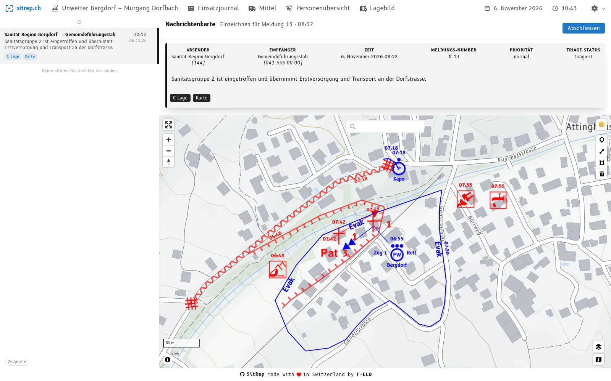
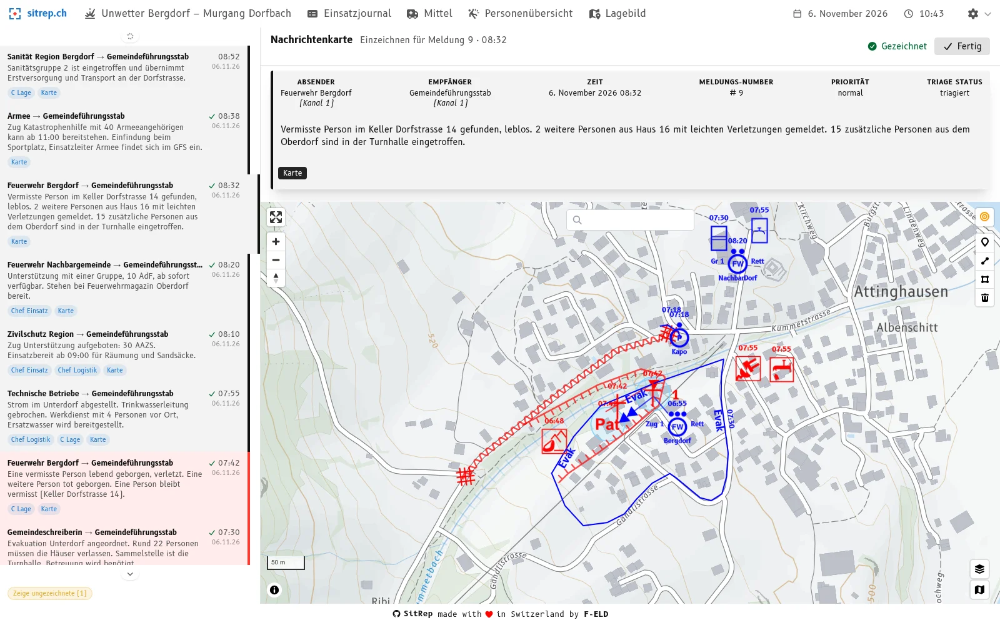
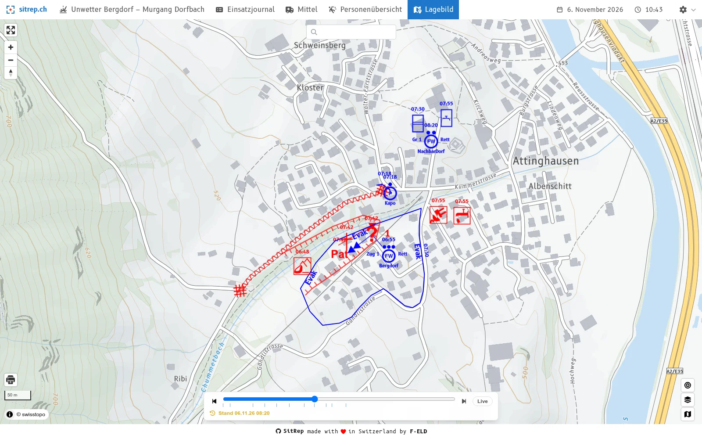

Tra un rapporto e l'altro lo stato maggiore guarda soprattutto una cosa: la carta alla parete. Chi passa vuole sapere a colpo d'occhio che cosa vale. È aggiornata agli ultimi messaggi, o è ancora appesa la situazione di un'ora fa?

Il problema lo conosce ogni stato maggiore che tiene la carta a mano. Il manuale dell'UFPP «Behelf Einsatz Lage» definisce la **carta informativa** uno «strumento di lavoro permanente per la registrazione e la valutazione continue del flusso di messaggi rilevante». Classicamente la tiene un responsabile della carta informativa su un lucido e lo cambia di tanto in tanto perché resti leggibile. Deve così riportare sul nuovo lucido tutto ciò che è ancora valido. Ci vuole tempo e spesso avviene troppo tardi o non avviene affatto. La carta diventa più difficile da capire e da leggere per lo stato maggiore.

Qui interviene la nuova **carta informativa** in [sitrep](), il software open source per la rappresentazione elettronica della situazione negli stati maggiori di condotta. È anche il naturale sviluppo del [nuovo triage]().

## La carta analogica resta, quella digitale si aggiunge

sitrep non vuole sostituire la carta informativa analogica. La carta alla parete resta un livello di riserva e un punto di riferimento per lo stato maggiore, al rapporto e nel frattempo. sitrep ne facilita la creazione e l'aggiornamento.

La novità: la carta è a disposizione di tutti nello stato maggiore anche in formato digitale. Chi la apre può ingrandire e leggere, per ogni simbolo, il messaggio corrispondente. La carta informativa nasce solo dai messaggi e resta così tracciabile.

## La stessa logica del triage

Il triage tratta i messaggi uno per uno, il più vecchio per primo, e stabilisce chi li riceve. La carta informativa è costruita allo stesso modo. Se assegnate un messaggio alla carta informativa, finisce a sinistra nella pila di messaggi, l'elenco dei messaggi che devono ancora essere disegnati. Vale la stessa regola del triage: scegliere un messaggio, disegnarlo, chiuderlo, poi arriva il successivo. Chi conosce il triage sa quindi anche tenere la carta informativa. Non serve alcun modulo di notifica da passare al responsabile della carta.

## Che cosa ne ricavate

- **Il riporto diventa più semplice.** L'elenco mostra ciò che deve ancora andare sulla carta. Ciò che è già disegnato in digitale lo riportate sulla carta analogica, invece di cercarlo prima nel giornale. Si risparmia tempo e il riporto avviene più spesso in tempo utile.
- **Un doppio controllo.** Gli errori si correggono rapidamente in digitale, prima di essere disegnati a mano. Il riporto è nello stesso tempo un secondo sguardo al messaggio.
- **Ogni segno ha un'origine.** Ogni oggetto appartiene a un messaggio. La domanda «Da dove viene questo segno?» riporta direttamente al messaggio, e la carta evidenzia che cosa un messaggio ha modificato: in verde ciò che è aggiunto, in azzurro ciò che è modificato, in rosso chiaro ciò che è rimosso.
- **Il film da riavvolgere.** Un disegno vale a partire dall'**ora del messaggio**. Nel quadro della situazione la carta può quindi essere riprodotta lungo tutto l'intervento, e ogni stato precedente è consultabile: per il rapporto, la consegna e il debriefing.
- **Nessun messaggio resta indietro.** Ogni messaggio segue lo stesso percorso: registrare, sottoporre a triage, disegnare, chiudere. La pila di messaggi mostra in ogni momento che cosa manca ancora.

## Provare

Su [demo.sitrep.ch](https://demo.sitrep.ch) registrate un messaggio, assegnatelo alla carta informativa e disegnatelo. Il tutorial [La vostra prima carta informativa]() vi guida passo per passo.

Provatelo nel vostro prossimo esercizio di stato maggiore e verificate quanto prima la situazione appare sulla carta. Se avete domande o volete introdurre sitrep nel vostro stato maggiore, scriveteci a [info@sitrep.ch](mailto:info@sitrep.ch).
