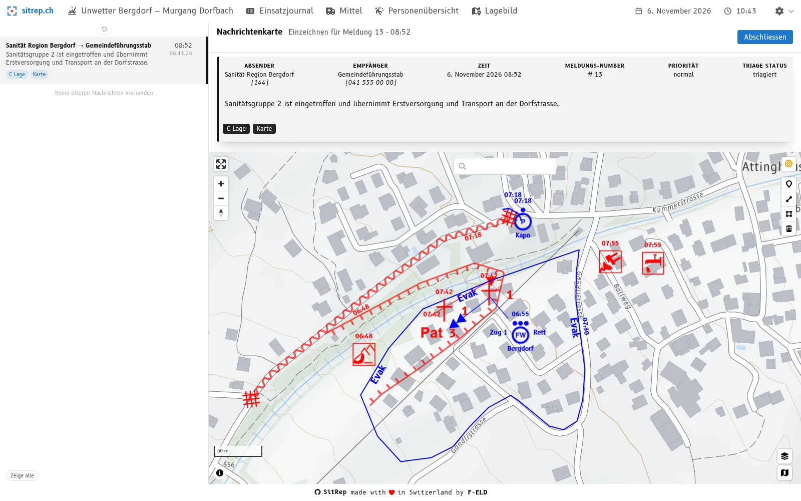
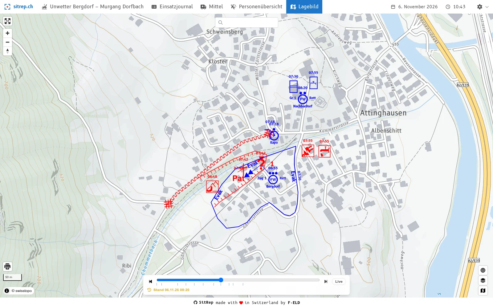
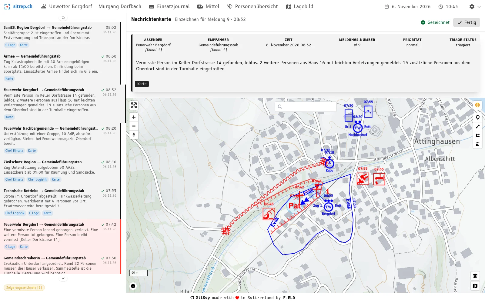

**09:20 Uhr im Lagezentrum.** Der Stabschef schaut auf die Karte: *«Die Sperrung an der Dorfstrasse: Seit wann gilt sie, und welche Meldung hat sie ausgelöst?»*

Das Problem kennt jeder Stab, der die Karte von Hand führt. Der BABS-Behelf «Einsatz Lage» nennt die **Nachrichtenkarte** ein «permanentes Arbeitsinstrument zur laufenden Erfassung und Auswertung des relevanten Meldeflusses». Klassisch führt sie ein Nachrichtenkartenführer auf Folie und wechselt sie von Zeit zu Zeit, damit sie lesbar bleibt. Dabei muss er alles, was weiter gilt, auf die neue Folie übertragen. Das kostet Zeit und Nerven und geschieht oft zu spät oder gar nicht. Das Lagebild leidet: Es wird für den Stab schwerer verständlich und lesbar.

Hier hilft die neue **Nachrichtenkarte** in [sitrep](), der Open-Source-Software für die Führungsunterstützung im Bevölkerungsschutz. Sie ersetzt die Karte an der Wand nicht, sondern erleichtert ihre Führung. Und sie ist die logische Weiterentwicklung der [neuen Triage]().

## Dieselbe Logik wie die Triage

Die Nachrichtenkarte ist genauso aufgebaut wie die Triage. Dort bearbeiten Sie Meldung für Meldung, die älteste zuerst, und legen fest, wer sie erhält. Weisen Sie eine Meldung der Nachrichtenkarte zu, landet sie in deren Arbeitsliste, und dort gilt dasselbe: Meldung wählen, einzeichnen, abschliessen, dann kommt die nächste. Wer die Triage kennt, kann deshalb auch die Nachrichtenkarte führen. Und das ganz ohne Meldezettel, der zur Kartenführung weitergereicht werden müsste.

## Was Sie davon haben

- **Das Übertragen wird einfacher.** Die Liste zeigt, was noch auf die Karte gehört. Was digital schon eingezeichnet ist, zeichnen Sie auf die analoge Karte ab, statt es erst im Journal zusammenzusuchen. Das spart Zeit und Nerven, und es geschieht eher rechtzeitig.
- **Eine doppelte Kontrolle.** Fehler lassen sich digital schnell korrigieren, bevor sie von Hand gezeichnet werden. Das Übertragen ist zugleich ein zweiter Blick auf die Meldung.
- **Jedes Zeichen hat eine Herkunft.** Jedes Objekt gehört zu einer Meldung. Die Frage des Stabschefs führt direkt zur Meldung zurück, und die Karte hebt hervor, was eine Meldung verändert hat: grün hinzugefügt, hellblau geändert, hellrot entfernt.
- **Der Film zum Zurückspulen.** Eine Zeichnung gilt ab der **Zeit der Meldung**. Im Lagebild lässt sich die Karte deshalb entlang des Einsatzes abspielen, und jeder frühere Stand ist abrufbar: für Rapport, Übergabe und Nachbesprechung.

## Die analoge Karte bleibt

sitrep will die manuelle Nachrichtenkarte nicht ablösen. Die Karte an der Wand bleibt eine Rückfallebene und für den Stab ein Orientierungspunkt, am Rapport und dazwischen. sitrep erleichtert es, sie zu erstellen und aktuell zu halten.

## Und das Lagebild?

Für Karten, die nicht aus Meldungen entstehen, etwa eine Führungskarte, legen Sie im Lagebild eigene Layer an. Die Nachrichtenkarte selbst entsteht nur über Meldungen und bleibt so nachvollziehbar.

## Ausprobieren

Testen Sie es auf [demo.sitrep.ch](https://demo.sitrep.ch). Wie es Schritt für Schritt geht, zeigt das Tutorial [Ihre erste Nachrichtenkarte](). Fragen und Rückmeldungen nehmen wir gerne unter [info@sitrep.ch](mailto:info@sitrep.ch) entgegen.
