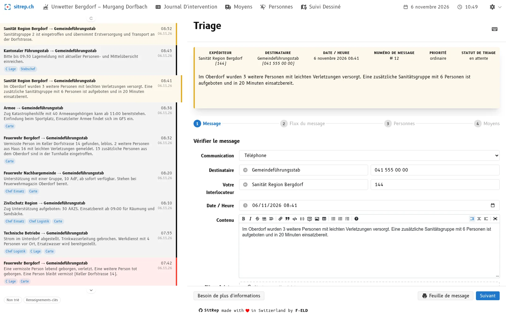
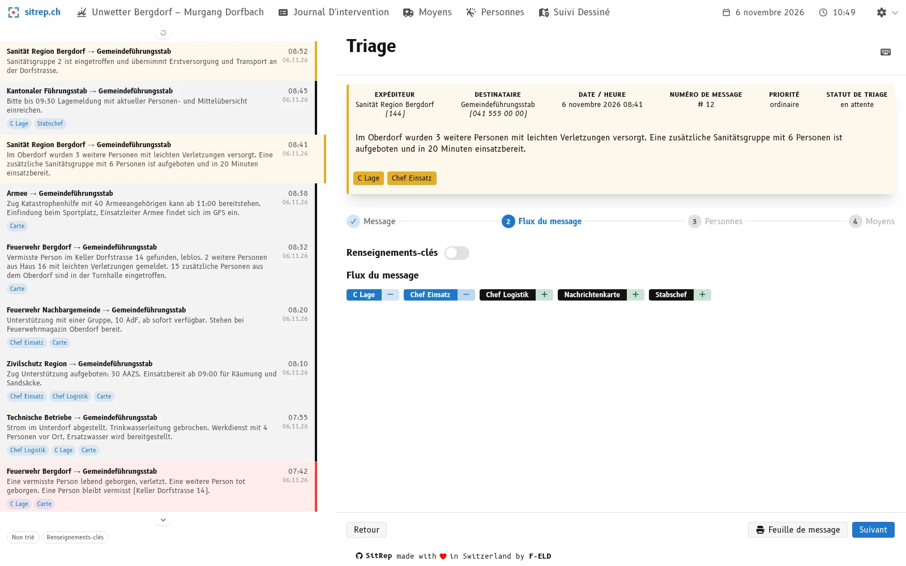
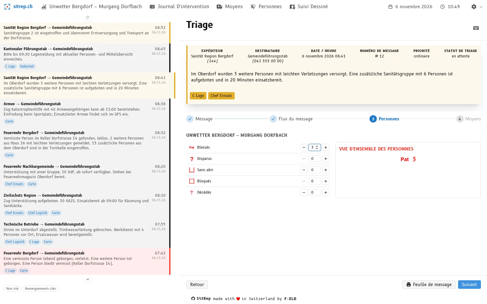
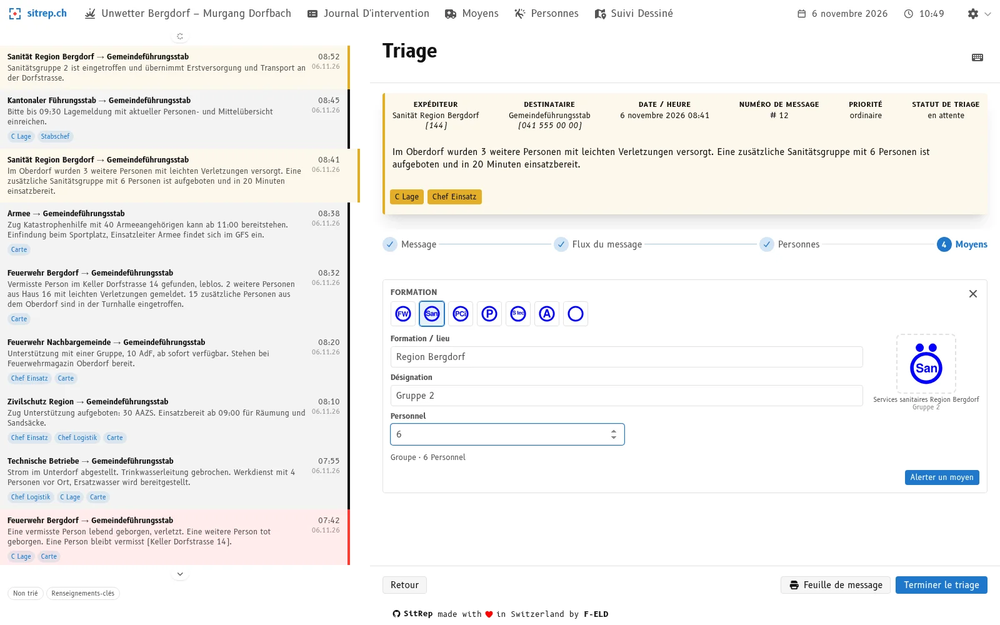
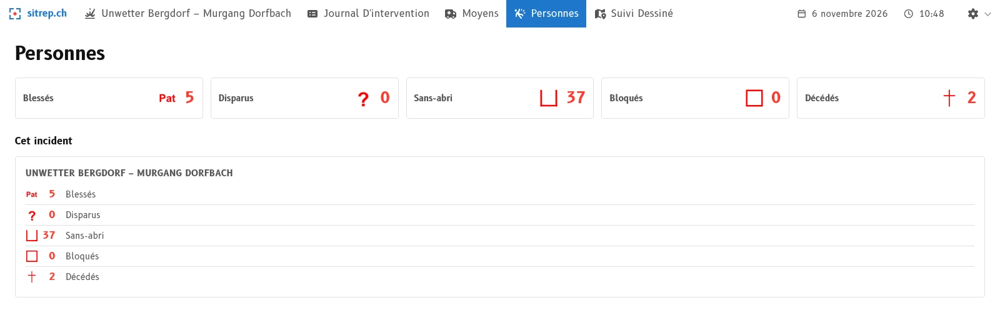
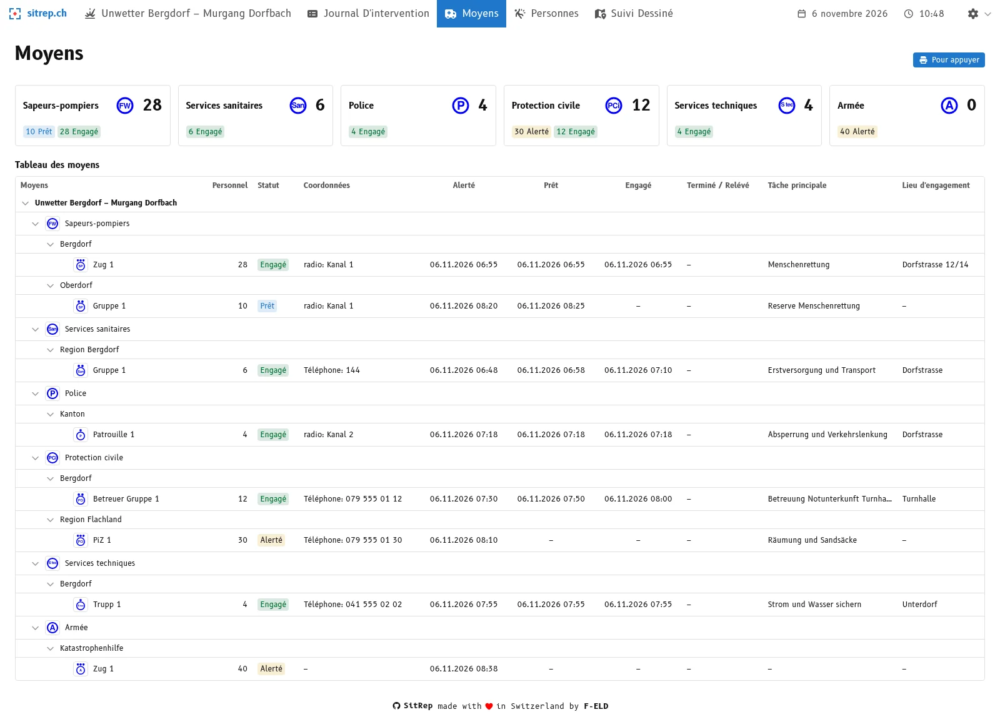
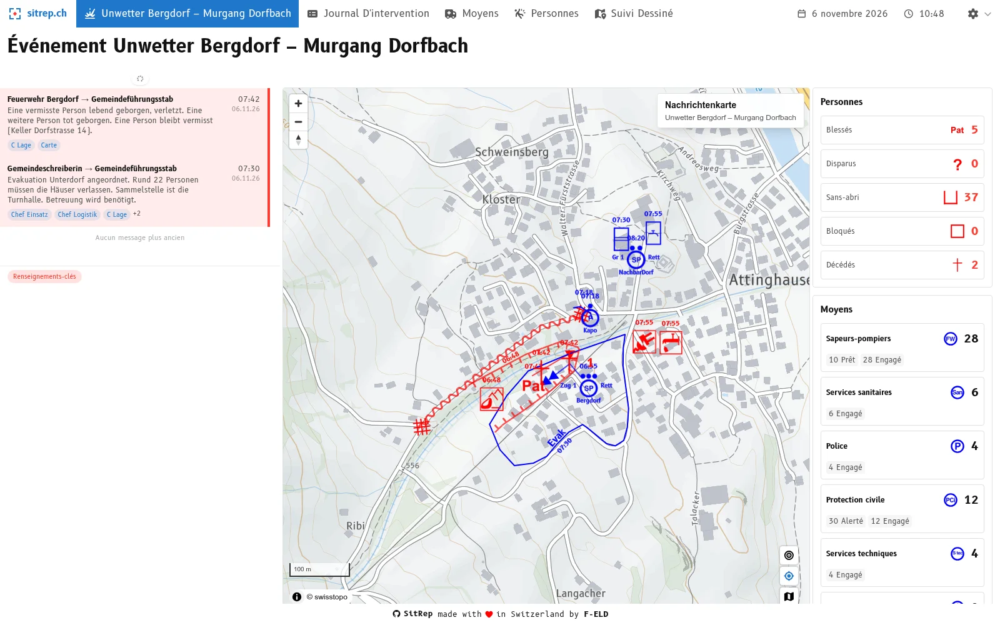

**08 h 45 au centre de situation.** L'état-major cantonal appelle : *« Merci de remettre d'ici 09 h 30 un rapport de situation avec la vue d'ensemble actuelle des personnes et des moyens. »*

Chaque minute compte maintenant. L'état-major veut des réponses :

- Combien de blessés avons-nous ?
- Combien de personnes sont encore portées disparues, et combien ont été retrouvées ?
- Quels moyens d'intervention sont mis sur pied, lesquels sont déjà engagés ? Avec combien de personnes ?

Les réponses se trouvent quelque part dans les messages des dernières heures. L'un feuillette le journal d'intervention, l'autre additionne sur un bout de papier. Cela prend du temps et des erreurs s'infiltrent : un message compté deux fois, un autre oublié, un état intermédiaire dépassé.

Pourtant, chacun de ces messages a déjà été lu et évalué une fois : lors du triage. C'est exactement là que la nouvelle vue de triage de [sitrep]() intervient, le logiciel open source d'aide à la conduite pour la protection de la population. Qui trie un message saisit uniquement ce que le message apporte de nouveau : « un disparu de moins, un blessé de plus », « section mise sur pied », « groupe engagé ». Les vues d'ensemble des personnes et des moyens en découlent d'elles-mêmes. Quand la demande arrive, la réponse se lit à l'écran.

Nous avons développé la nouvelle vue de triage avec des organisations choisies et l'avons testée lors d'un grand exercice. Avec la release [v26.11.0](https://github.com/f-eld-ch/sitrep/releases/tag/v26.11.0), elle est disponible pour tous les utilisateurs de sitrep.

Dans cet article, nous montrons comment cela fonctionne et pourquoi le triage est le bon endroit pour le faire. Vous verrez aussi pourquoi cela n'entraîne aucun travail supplémentaire.

## Ce que dit le manuel de conduite

Le manuel de l'OFPP « Aide-mémoire Intervention suivi de la situation » fixe clairement le parcours du message :

- Le **triage** est le point où les messages entrent dans le cycle de traitement de la situation. Tous les messages y sont examinés, priorisés et transmis aux bons services. Lors du triage, on détermine aussi quels contenus sont saisis dans quels produits.
- La **vue d'ensemble des moyens** fait partie des produits standard du domaine Situation. C'est l'aperçu sous forme de tableau de tous les moyens d'intervention : mis en piquet, mis sur pied, prêts, engagés ou prévus pour être relevés.
- Sur la **paroi d'affichage**, le flash des faits, la carte de renseignements et la vue d'ensemble des moyens vont ensemble.

Le manuel dit donc : le triage décide **où** une information circule. sitrep fait le pas logique suivant. L'information n'arrive pas seulement au bon domaine, mais directement dans la bonne vue d'ensemble.

## Pourquoi cela doit se faire lors du triage

On pourrait aussi tenir les vues d'ensemble à jour « en cas de besoin », par exemple chaque heure ou avant le rapport. C'est la méthode classique. Quatre raisons s'y opposent.

**1. L'information est la plus fraîche quand le message arrive.**
La personne au triage a le message sous les yeux. Elle sait ce qu'il signifie et peut poser une question immédiatement en cas de doute. Une heure plus tard, quelqu'un doit relire et interpréter le message.

**2. Recompter est source d'erreurs.**
Qui additionne périodiquement tous les messages doit reprendre chacun d'eux. C'est ainsi que naissent les doubles comptages et que des messages sont oubliés. Qui saisit chaque changement exactement une fois compte automatiquement juste.

**3. Tout le monde travaille avec les mêmes chiffres.**
Le manuel exige que les produits textuels et les produits graphiques ne se contredisent pas. Cela n'est possible que s'il existe une source commune. Dans sitrep, le dashboard et les vues d'ensemble des personnes et des moyens sont toujours calculés à partir des mêmes saisies de triage.

**4. Chaque chiffre a une origine.**
Quand l'état-major demande « D'où viennent les 37 sans-abri ? », on peut remonter jusqu'au message. Avec un tableau tenu après coup, c'est souvent impossible.

En bref : **l'information est saisie une fois, au bon endroit du processus, puis disponible dans toutes les vues d'ensemble.**

## La nouvelle vue de triage en quatre étapes

La vue de triage guide à travers quatre étapes. L'exemple est un événement fictif : une coulée de boue dans le village de « Bergdorf » après des intempéries. Tous les noms et tous les chiffres sur les images sont inventés. Les captures d'écran montrent l'interface en allemand.

### 1. Vérifier le message

L'expéditeur, le destinataire, l'heure et le contenu sont contrôlés et corrigés si nécessaire. Le message reste toujours visible en haut, aussi dans les étapes suivantes.

### 2. Définir le flux du message

On décide ici qui doit recevoir le message : Chef Einsatz, carte de renseignements, C Lage, Chef Logistik, Stabschef. Les messages importants peuvent être marqués comme **renseignements-clés**.

### 3. Saisir les personnes

On saisit ici le nombre de personnes, dans les cinq catégories : blessés, disparus, personnes bloquées, sans-abri et décès.

Important : on saisit uniquement ce que **le message apporte de nouveau**. Si le service sanitaire annonce trois blessés légers de plus, on inscrit « +3 » pour les blessés. Si une personne auparavant portée disparue a été retrouvée et qu'elle est blessée, on inscrit « −1 » pour les disparus et « +1 » pour les blessés. À droite, on voit tout de suite l'effet sur la vue d'ensemble des personnes.

### 4. Mettre sur pied et engager des moyens

Les messages concernent souvent des moyens d'intervention. On note ici ce qui leur est arrivé. Chaque changement est inscrit dans le tableau des moyens avec l'**heure du message**. Un moyen d'intervention passe par ces stations :

**Mis sur pied → Prêt → Engagé → Relevé**

Les quatre actions principales :

- **Mettre sur pied :** un nouveau moyen d'intervention est saisi avec sa formation, son nom, son lieu de stationnement et son effectif. sitrep propose la taille adaptée (équipe, groupe, section) d'après le nombre de personnes.
- **Annoncer prêt :** le moyen est arrivé ou prêt.
- **Disposer et engager :** le moyen reçoit une mission (tâche principale) et un lieu d'engagement, puis il est engagé. Les deux sont obligatoires, afin que le tableau des moyens ne montre jamais un moyen engagé sans mission.
- **Relever :** un autre moyen prend le relais. La mission et le lieu d'engagement passent automatiquement au moyen de relève. Le moyen relevé reste dans la vue d'ensemble avec son historique d'engagement.

S'y ajoutent les actions du quotidien de l'intervention : réaffecter, terminer l'engagement, libérer, réactiver lors d'interventions de plusieurs jours et tenir à jour la joignabilité (canal radio, téléphone).

Avec « Terminer le triage », tout est enregistré en une seule fois.

## Pas de travail supplémentaire, mais une partie du processus

Le traitement numérique de la situation ne doit pas être un travail supplémentaire. Personne ne doit saisir une seconde fois dans un outil numérique des informations que l'aide à la conduite traite de toute façon. Il doit faire partie intégrante du processus de traitement : le travail dans l'outil est le travail dans le processus.

C'est exactement ainsi que la vue de triage est construite. Elle suit les étapes que le manuel de conduite prévoit pour le triage : vérifier le message, définir le flux du message, saisir les personnes et les moyens. Ce qui est décidé lors du triage est en même temps l'entrée dans les vues d'ensemble. Il n'y a pas de seconde saisie.

Ainsi, le bon déroulement est conservé même sous la pression du temps. Aux étapes 3 et 4, on ne saisit quelque chose que si le message concerne des personnes ou des moyens d'intervention. Sinon, on avance rapidement avec « Suivant ».

## Le résultat : des vues d'ensemble à l'état du triage

Retour à l'exemple de l'introduction : à 08 h 45, le canton demande un rapport de situation avec la vue d'ensemble des personnes et des moyens. Dans l'événement « Coulée de boue à Bergdorf », les messages reçus jusqu'ici sont triés. La réponse au canton n'est donc plus un exercice de calcul : l'information se lit à tout moment, à l'état du dernier triage, dans la vue d'ensemble des personnes et dans celle des moyens.

### Vue d'ensemble des personnes

La vue d'ensemble des personnes montre les totaux des cinq catégories. Elle correspond à tout moment à l'état actuel du triage, sans que personne n'ait à additionner quoi que ce soit.

### Vue d'ensemble des moyens

La vue d'ensemble des moyens s'inspire du tableau des moyens du manuel de conduite. Elle est regroupée par formation et indique pour chaque moyen :

- l'effectif et le **statut** (mis sur pied, prêt, engagé, relevé)
- la **joignabilité** (canal radio ou téléphone)
- les **moments** de la mise sur pied, de la disponibilité, du début d'engagement et de la relève
- la **tâche principale** et le lieu d'engagement

Qui a besoin de la vue d'ensemble pour le rapport ou la paroi d'affichage l'imprime directement.

Un détail qui nous importait :

- Dans les totaux en haut, **seuls les moyens engagés** comptent. Les moyens mis sur pied et prêts sont indiqués séparément. Ainsi, la force d'intervention n'est pas surestimée. Dans l'exemple : l'armée est mise sur pied (40 personnes), mais pas encore engagée, donc la somme y indique 0.

### Dashboard

Le dashboard montre la situation actuelle en un coup d'œil : les derniers messages, la carte de renseignements, la vue d'ensemble des personnes et les moyens par formation. Il est conçu comme **information actuelle pour l'état-major**, par exemple sur un projecteur ou un téléviseur dans le local de conduite. Il se met à jour en continu.

## Ce que cela apporte aux états-majors

- **Plus rapide :** les vues d'ensemble sont prêtes quand la question arrive. Le centre de situation ne perd pas de temps à additionner.
- **Moins d'erreurs :** chaque changement est saisi exactement une fois, là où le message arrive. Les doubles comptages et les messages oubliés deviennent moins probables.
- **Traçable :** chaque chiffre renvoie au message qui l'a déclenché.
- **Moins de coordination :** le dashboard et les vues d'ensemble des personnes et des moyens montrent les mêmes chiffres. Pas de paperasse avec des états divergents.
- **Soulagement pour les spécialistes :** la fonction de « responsable des vues d'ensemble et des listes » du manuel de conduite est en grande partie assumée par le triage. Le personnel peut se concentrer davantage sur l'appréciation et la conduite.

## Où en est le traitement de la situation chez vous ?

Que vous travailliez avec des feuilles, un tableur ou un autre outil : testez-le lors de votre prochain exercice d'état-major.

- Combien de temps faut-il pour que les vues d'ensemble des personnes et des moyens soient à jour ?
- À quelle fréquence les mêmes informations doivent-elles être saisies plusieurs fois ?
- L'outil aide-t-il l'aide à la conduite à respecter les bons processus sous la pression du temps, ou est-il un obstacle ?

Si ces questions vous sont familières, essayez sitrep vous-même : [demo.sitrep.ch](https://demo.sitrep.ch). Ou nous vous montrons volontiers comment sitrep s'en sort, sur un événement d'exemple ou lors de votre prochain exercice. Écrivez-nous à [info@sitrep.ch](mailto:info@sitrep.ch).

La vue de triage est disponible pour tous avec la release v26.11.0.
