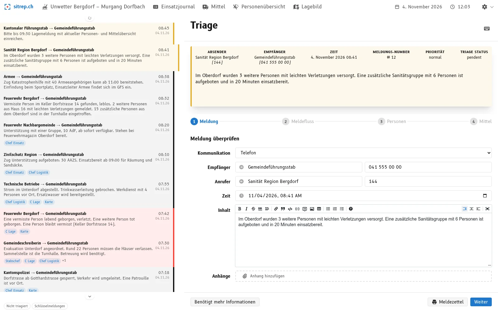
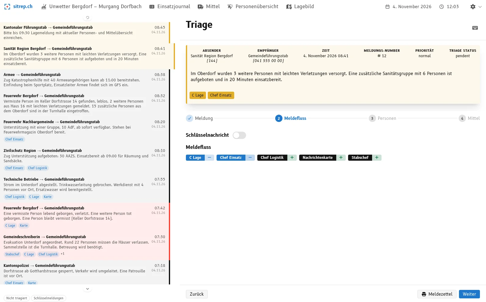
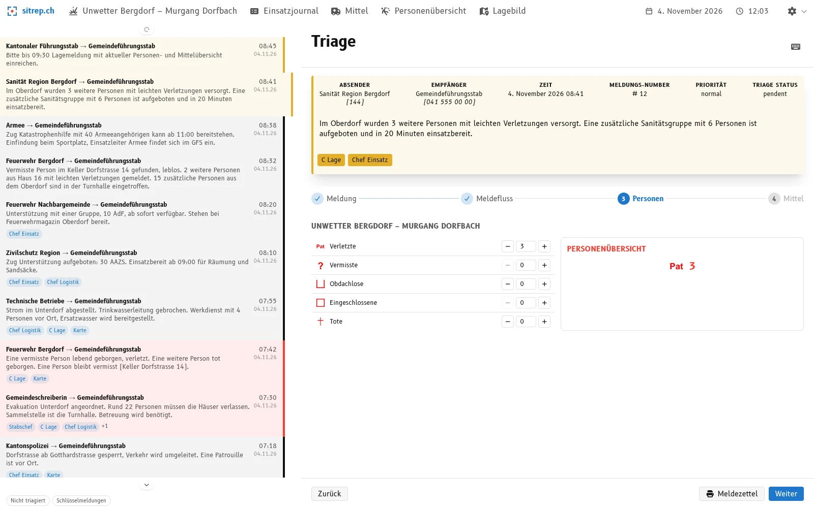
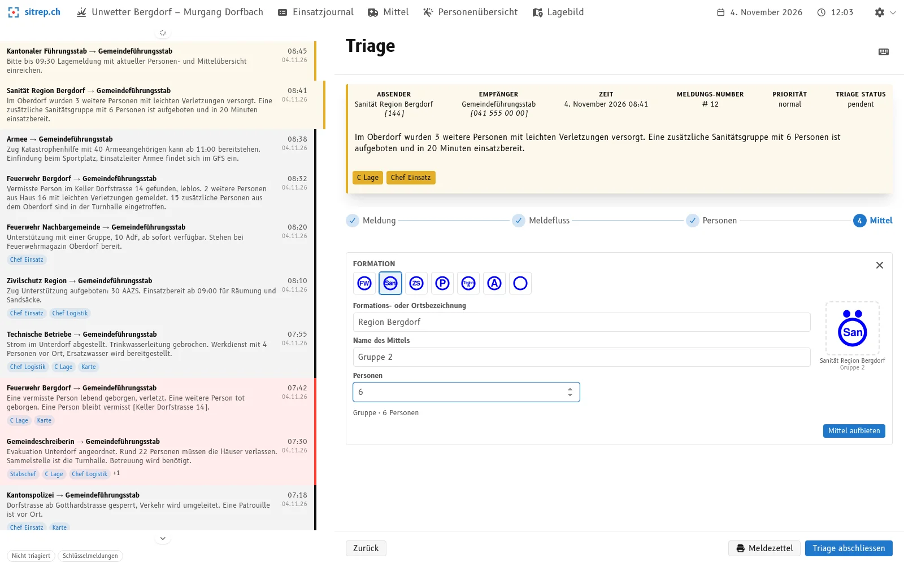
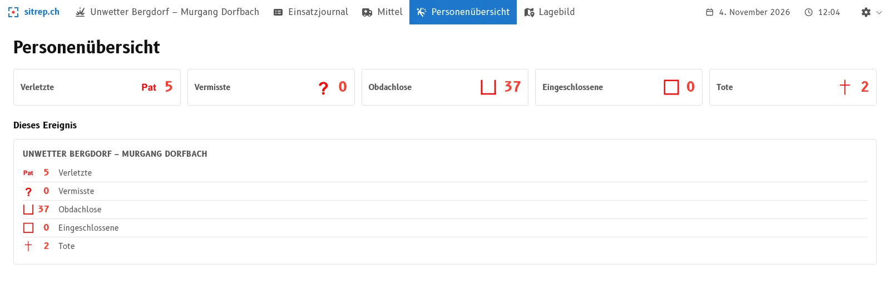
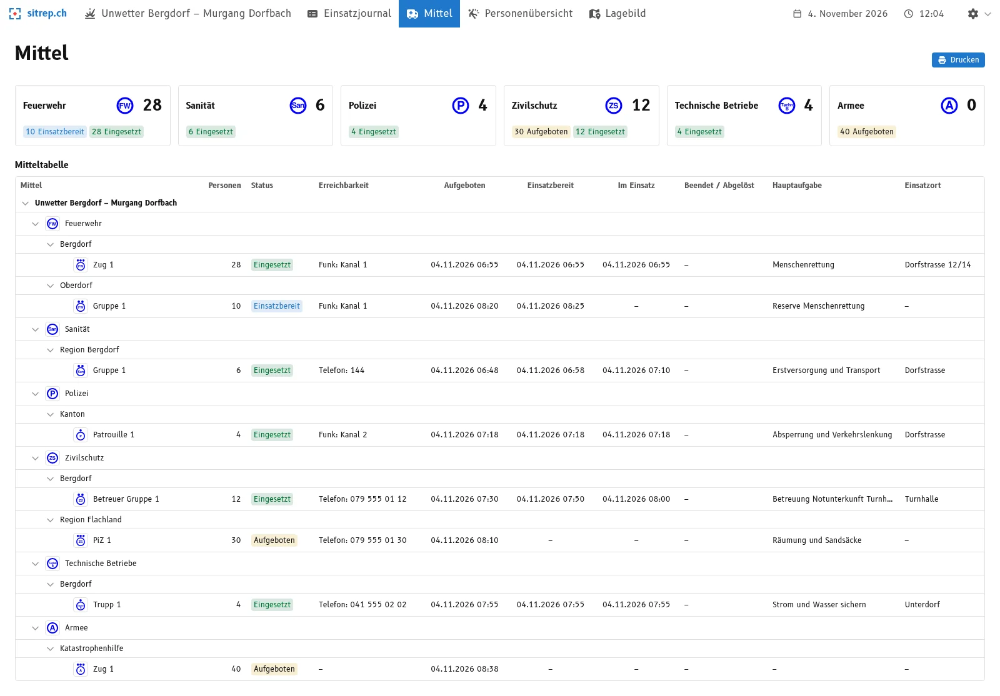
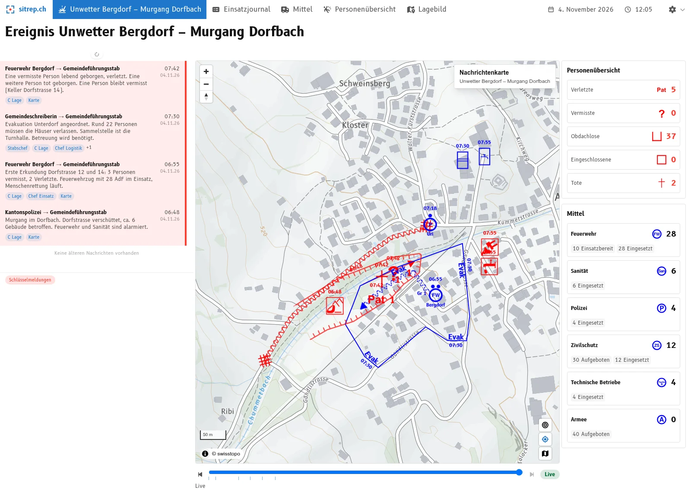

**Ore 08:45 nel centro situazione.** Lo stato maggiore cantonale si fa sentire: *«Si prega di inoltrare entro le 09:30 un rapporto sulla situazione con il compendio aggiornato delle persone e dei mezzi.»*

Ora ogni minuto conta. Lo stato maggiore vuole risposte:

- Quanti feriti abbiamo?
- Quanti dispersi sono ancora aperti, e quanti sono stati ritrovati?
- Quali mezzi d'intervento sono chiamati, quali già impiegati? Con quante persone?

Le risposte si trovano da qualche parte nei messaggi delle ultime ore. Uno sfoglia il giornale d'intervento, un altro somma su un foglietto. Costa tempo e si insinuano errori: un messaggio contato due volte, uno dimenticato, uno stato intermedio superato.

Eppure ognuno di questi messaggi è già stato letto e valutato una volta: nel triage. È proprio qui che interviene la nuova vista di triage di [sitrep](), il software open source per l'aiuto alla condotta nella protezione della popolazione. Chi sottopone a triage un messaggio registra soltanto ciò che il messaggio dice di nuovo: «un disperso in meno, un ferito in più», «plotone chiamato», «gruppo impiegato». I compendi delle persone e dei mezzi ne derivano da soli. Quando arriva la richiesta, la risposta si legge sullo schermo.

Abbiamo sviluppato la nuova vista di triage insieme a organizzazioni selezionate e l'abbiamo testata in un grande esercizio. Con la release [v26.11.0](https://github.com/f-eld-ch/sitrep/releases/tag/v26.11.0) è disponibile per tutti gli utenti di sitrep.

In questo articolo mostriamo come funziona e perché il triage è il posto giusto per farlo. Scoprirete anche perché non comporta alcun lavoro supplementare.

## Cosa dice il manuale di condotta

Il manuale dell'UFPP «Behelf Einsatz Lage» stabilisce chiaramente il percorso del messaggio:

- Il **triage** è il punto in cui i messaggi entrano nel ciclo di elaborazione della situazione. Qui tutti i messaggi vengono esaminati, classificati per priorità e inoltrati ai posti giusti. Durante il triage si stabilisce anche quali contenuti vengono registrati in quali prodotti.
- Il **compendio dei mezzi** fa parte dei prodotti standard del settore Situazione. È la panoramica in forma di tabella di tutti i mezzi d'intervento: messi in picchetto, chiamati, pronti, impiegati o previsti per l'avvicendamento.
- Sulla **parete ANSIT** stanno insieme il flash dei fatti, la carta informativa e il compendio dei mezzi.

Il manuale dice dunque: il triage decide **dove** confluisce un'informazione. sitrep compie il passo logico successivo. L'informazione non arriva solo al settore giusto, ma direttamente nel compendio giusto.

## Perché deve avvenire nel triage

Si potrebbero aggiornare i compendi anche «all'occorrenza», per esempio ogni ora o prima del rapporto. È il metodo classico. Quattro motivi vi si oppongono.

**1. L'informazione è più fresca quando arriva il messaggio.**
La persona al triage ha il messaggio davanti a sé. Sa cosa significa e può chiedere subito in caso di dubbi. Un'ora dopo, qualcuno deve rileggere e interpretare di nuovo il messaggio.

**2. Ricontare è soggetto a errori.**
Chi somma periodicamente tutti i messaggi deve riprendere in mano ogni messaggio. Così nascono i conteggi doppi e i messaggi vengono dimenticati. Chi registra ogni modifica esattamente una volta conta automaticamente giusto.

**3. Tutti lavorano con gli stessi numeri.**
Il manuale richiede che i prodotti testuali e quelli grafici non si contraddicano. Questo è possibile solo con una fonte comune. In sitrep, il dashboard e i compendi delle persone e dei mezzi sono sempre calcolati dalle stesse registrazioni di triage.

**4. Ogni numero ha un'origine.**
Quando lo stato maggiore chiede «Da dove vengono i 37 senzatetto?», si può risalire al messaggio. Con una tabella aggiornata a posteriori, spesso non è più possibile.

In breve: **l'informazione viene registrata una volta, nel punto giusto del processo, e poi è disponibile in tutti i compendi.**

## Il nuovo triage in quattro passaggi

La vista di triage guida attraverso quattro passaggi. L'esempio è un evento fittizio: una colata detritica nel villaggio di «Bergdorf» dopo un maltempo. Tutti i nomi e tutti i numeri nelle immagini sono inventati. Le schermate mostrano l'interfaccia in tedesco.

### 1. Verificare il messaggio

Mittente, destinatario, ora e contenuto vengono controllati e, se necessario, corretti. Il messaggio resta sempre visibile in alto, anche nei passaggi successivi.

### 2. Definire il flusso dei messaggi

Qui si decide chi deve ricevere il messaggio: Chef Einsatz, carta informativa, C Lage, Chef Logistik, Stabschef. I messaggi importanti possono essere contrassegnati come **notizie chiave**.

### 3. Registrare le persone

Qui si registrano i numeri di persone, nelle cinque categorie: feriti, dispersi, intrappolati, senzatetto e vittime.

Importante: si registra soltanto ciò che **il messaggio dice di nuovo**. Se il servizio sanitario segnala altri tre feriti lievi, si inserisce «+3» per i feriti. Se una persona prima dispersa è stata ritrovata ed è ferita, si inserisce «−1» per i dispersi e «+1» per i feriti. A destra si vede subito l'effetto sul compendio delle persone.

### 4. Chiamare e impiegare i mezzi

I messaggi riguardano spesso mezzi d'intervento. Qui si annota che cosa è successo con loro. Ogni modifica viene registrata nella tabella dei mezzi con l'**ora del messaggio**. Un mezzo d'intervento attraversa queste stazioni:

**Chiamato → Pronto → Impiegato → Avvicendato**

Le quattro azioni principali:

- **Chiamare:** un nuovo mezzo d'intervento viene registrato con formazione, nome, luogo di stazionamento e numero di persone. sitrep propone la dimensione adatta (squadra, gruppo, plotone) in base al numero di persone.
- **Annunciare pronto:** il mezzo è arrivato o è pronto.
- **Disporre e impiegare:** il mezzo riceve un compito (compito principale) e un luogo d'intervento e viene impiegato. Entrambi sono obbligatori, affinché la tabella dei mezzi non mostri mai un mezzo impiegato senza compito.
- **Avvicendare:** un altro mezzo subentra. Compito e luogo d'intervento passano automaticamente al mezzo subentrante. Il mezzo avvicendato resta nel compendio con la sua storia d'intervento.

A ciò si aggiungono le azioni per la quotidianità dell'intervento: ridisporre, concludere l'intervento, congedare, riattivare negli interventi di più giorni e curare la raggiungibilità (canale radio, telefono).

Con «Concludere il triage» tutto viene salvato in un colpo solo.

## Nessun lavoro supplementare, ma parte del processo

L'elaborazione digitale della situazione non deve essere un lavoro supplementare. Nessuno deve trasferire una seconda volta in uno strumento digitale informazioni che l'aiuto alla condotta elabora comunque. Deve essere una componente fissa del processo di elaborazione: il lavoro nello strumento è il lavoro nel processo.

La vista di triage è costruita proprio così. Segue i passaggi che il manuale di condotta prevede per il triage: verificare il messaggio, definire il flusso dei messaggi, registrare persone e mezzi. Ciò che si decide nel triage è allo stesso tempo la voce nei compendi. Non c'è una seconda registrazione.

Così il giusto svolgimento si mantiene anche sotto pressione. Nei passaggi 3 e 4 si registra qualcosa solo se il messaggio riguarda persone o mezzi d'intervento. Altrimenti si procede rapidamente con «Avanti».

## Il risultato: compendi allo stato del triage

Torniamo all'esempio dell'introduzione: alle 08:45 il Cantone chiede un rapporto sulla situazione con il compendio delle persone e dei mezzi. Nell'evento «Colata detritica a Bergdorf» i messaggi finora ricevuti sono sottoposti a triage. La risposta al Cantone non è più un problema di calcolo: l'informazione si legge in ogni momento, allo stato dell'ultimo triage, dal compendio delle persone e da quello dei mezzi.

### Compendio delle persone

Il compendio delle persone mostra i totali delle cinque categorie. Corrisponde in ogni momento allo stato attuale del triage, senza che qualcuno debba sommare qualcosa.

### Compendio dei mezzi

Il compendio dei mezzi si ispira alla tabella dei mezzi del manuale di condotta. È raggruppato per formazione e mostra per ogni mezzo:

- numero di persone e **stato** (chiamato, pronto, impiegato, avvicendato)
- **raggiungibilità** (canale radio o telefono)
- i **momenti** di chiamata, disponibilità, inizio dell'intervento e avvicendamento
- **compito principale** e luogo d'intervento

Chi ha bisogno del compendio per il rapporto o per la parete ANSIT lo stampa direttamente.

Un dettaglio che ci stava a cuore:

- Nei totali in alto contano **solo i mezzi impiegati**. I mezzi chiamati e quelli pronti vengono indicati separatamente. Così la forza d'intervento non viene sovrastimata. Nell'esempio: l'esercito è chiamato (40 persone), ma non ancora impiegato, perciò nella somma compare 0.

### Dashboard

Il dashboard mostra la situazione attuale a colpo d'occhio: gli ultimi messaggi, la carta informativa, il compendio delle persone e i mezzi per formazione. È pensato come **informazione aggiornata per lo stato maggiore**, per esempio su un proiettore o un televisore nel locale di condotta. Si aggiorna continuamente.

## Che cosa porta agli stati maggiori

- **Più veloce:** i compendi sono pronti quando arriva la domanda. Il centro situazione non perde tempo a sommare.
- **Meno errori:** ogni modifica viene registrata esattamente una volta, dove arriva il messaggio. Conteggi doppi e messaggi dimenticati diventano meno probabili.
- **Tracciabile:** ogni numero riconduce al messaggio che l'ha generato.
- **Meno coordinamento:** il dashboard e i compendi delle persone e dei mezzi mostrano gli stessi numeri. Niente burocrazia cartacea con stati divergenti.
- **Sollievo per gli specialisti:** la funzione di «responsabile di compendi ed elenchi» del manuale di condotta viene in gran parte assunta dal triage. Il personale può concentrarsi di più su valutazione e condotta.

## A che punto è l'elaborazione della situazione da voi?

Che lavoriate con fogli, tabelle o un altro strumento: verificatelo nel prossimo esercizio di stato maggiore.

- Quanto tempo ci vuole prima che i compendi delle persone e dei mezzi siano aggiornati?
- Quanto spesso le stesse informazioni devono essere registrate più volte?
- Lo strumento aiuta l'aiuto alla condotta a rispettare i processi corretti sotto pressione, o è d'intralcio?

Se queste domande vi suonano familiari, provate sitrep direttamente voi stessi: [demo.sitrep.ch](https://demo.sitrep.ch). Oppure vi mostriamo volentieri come se la cava sitrep, con un evento di esempio o nel vostro prossimo esercizio. Scriveteci a [info@sitrep.ch](mailto:info@sitrep.ch).

La vista di triage è disponibile per tutti con la release v26.11.0.
