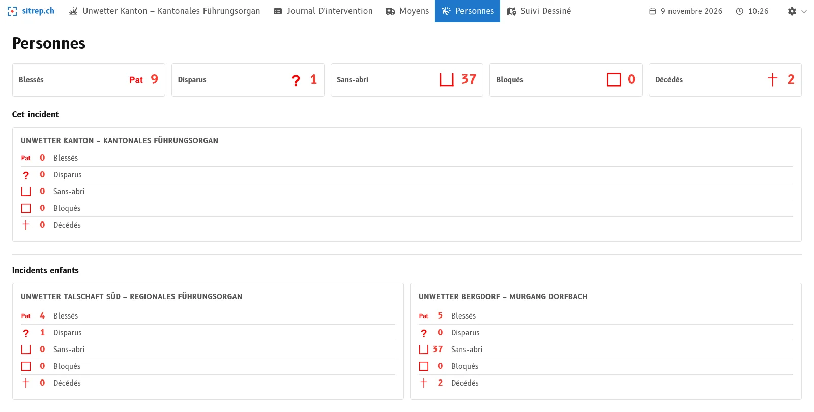
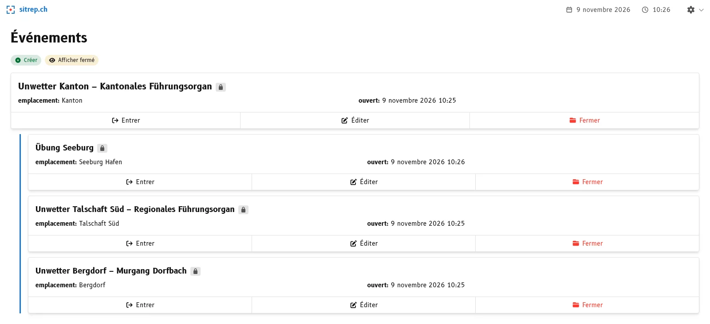

Un état-major régional ou cantonal ne conduit pas l'intervention sur place. Il coordonne la maîtrise de l'événement au niveau supérieur et soutient les forces d'intervention locales. Pour cela, il répartit les moyens que les communes ou les régions demandent : personnel, matériel, véhicules. Où il les envoie dépend de l'endroit où ils sont le plus urgemment nécessaires.

Pour bien décider, l'état-major supérieur a besoin de beaucoup d'informations : combien de personnes sont touchées, quels moyens sont engagés où, que reste-t-il de libre ? Ces indications sont fournies par les états-majors subordonnés, par téléphone, par courriel ou par message. Cela prend du temps et c'est sujet aux erreurs : les chiffres sont ressaisis, additionnés et périmés avant d'arriver. Les deux parties perdent ainsi un temps qui manque à l'intervention.

La **hiérarchie des événements** dans [sitrep]() facilite ce travail et aide à disposer d'informations plus actuelles. Chaque état-major tient son événement comme avant, et l'état-major supérieur voit la situation de tous les états-majors subordonnés réunie. Cela vaut pour toute hiérarchie d'états-majors de conduite, par exemple pour un état-major régional auquel sont subordonnés plusieurs états-majors communaux, ou pour l'état-major cantonal au-dessus des régions.

## Ce que vous y gagnez

- **Des chiffres actuels sans questions.** Les chiffres proviennent des événements des états-majors subordonnés. Dès qu'un message y est saisi et trié, il apparaît chez l'état-major supérieur. Personne n'a besoin de demander ou de ressaisir, et les états-majors subordonnés annoncent plus rarement leur situation séparément.
- **Les personnes avec leur origine.** La vue d'ensemble des personnes de l'état-major supérieur additionne les chiffres de tous les états-majors subordonnés. En dessous, ils figurent par événement, et l'on voit d'où vient un chiffre.
- **Les moyens en un coup d'œil.** La vue d'ensemble des moyens montre les moyens des états-majors subordonnés comme des groupes à part et les intègre dans les totaux.
- **Les cartes de renseignements des états-majors subordonnés.** L'état-major supérieur voit aussi leurs cartes de renseignements, et donc ce qui a été dessiné et annoncé, pas seulement les chiffres.

## Comment le mettre en place

L'état-major supérieur rattache à son événement les événements des états-majors subordonnés. Dans la liste des événements, ils figurent ensuite en retrait en dessous.

## Les états-majors subordonnés travaillent comme avant

Chaque événement reste un événement à part entière : avec ses propres messages, ses propres domaines et ses propres accès. Il est aussi clos individuellement. La clôture de l'événement supérieur ne change rien aux événements subordonnés.

## Essayer

Sur [demo.sitrep.ch](https://demo.sitrep.ch), créez deux événements et choisissez pour l'un d'eux l'autre dans le champ **Événement supérieur**. Vous voyez alors les chiffres des deux événements chez l'état-major supérieur. Les étapes sont décrites dans le [guide](), et l'article [Événements supérieurs et subordonnés]() en explique le contexte.

Dirigez-vous un état-major supérieur ou êtes-vous subordonné à l'un d'eux ? Écrivez-nous à [info@sitrep.ch](mailto:info@sitrep.ch) pour nous dire comment vous organisez aujourd'hui la collaboration entre les états-majors et ce que vous souhaitez. Vos retours façonnent la manière dont nous faisons évoluer la hiérarchie.
