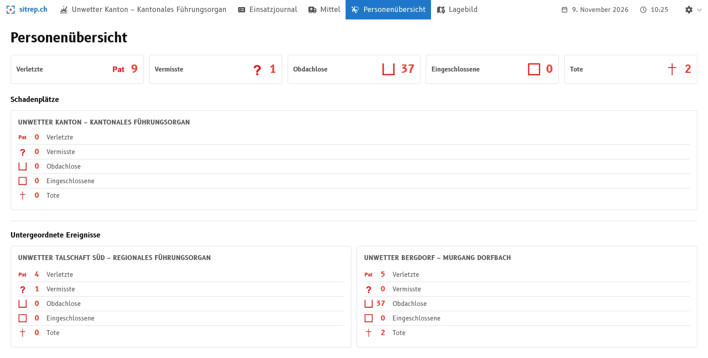
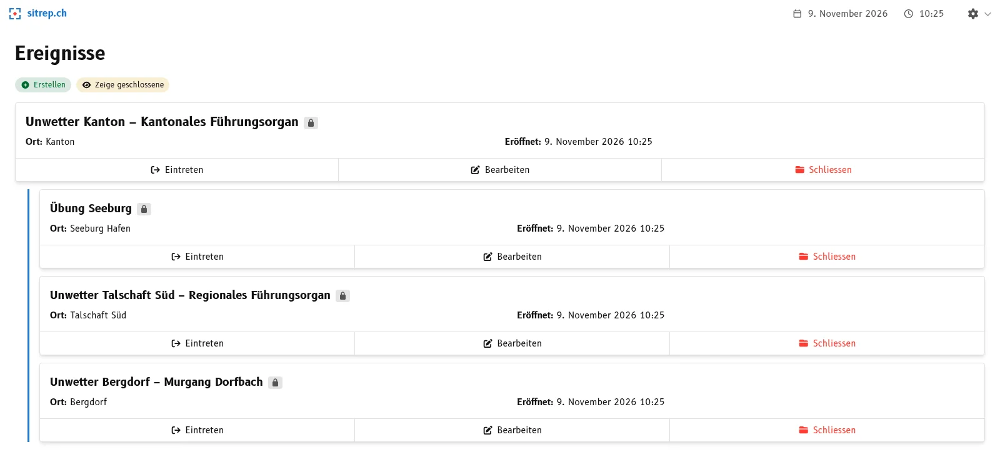

Uno stato maggiore regionale o cantonale non conduce l'intervento sul posto. Coordina la gestione dell'evento a livello sovraordinato e sostiene le forze d'intervento locali. A tal fine distribuisce i mezzi richiesti dai Comuni o dalle regioni: personale, materiale, veicoli. Dove li invia dipende da dove servono con maggiore urgenza.

Per decidere bene, lo stato maggiore sovraordinato ha bisogno di molte informazioni: quante persone sono colpite, quali mezzi sono impiegati dove, che cosa è ancora libero? Queste indicazioni le forniscono gli stati maggiori subordinati, per telefono, e-mail o messaggio. Ci vuole molto tempo ed è soggetto a errori: i dati vengono riscritti, sommati e sono superati prima di arrivare. Entrambe le parti perdono così tempo che manca all'intervento.

La **gerarchia degli eventi** in [sitrep]() facilita questo lavoro e aiuta ad avere informazioni più aggiornate. Ogni stato maggiore tiene il proprio evento come prima, e lo stato maggiore sovraordinato vede riassunta la situazione di tutti gli stati maggiori subordinati. Questo vale per qualsiasi gerarchia di stati maggiori di condotta, per esempio per uno stato maggiore regionale cui sono subordinati più stati maggiori comunali, o per lo stato maggiore cantonale al di sopra delle regioni.

## Che cosa ne ricavate

- **Dati aggiornati senza richieste.** I dati provengono dagli eventi degli stati maggiori subordinati. Non appena lì un messaggio è registrato e sottoposto a triage, compare presso lo stato maggiore sovraordinato. Nessuno deve chiedere o riscrivere, e gli stati maggiori subordinati segnalano più raramente la loro situazione a parte.
- **Le persone con la loro origine.** Il compendio delle persone dello stato maggiore sovraordinato somma i dati di tutti gli stati maggiori subordinati. Sotto figurano per evento, e si vede da dove viene un dato.
- **I mezzi a colpo d'occhio.** Il compendio dei mezzi mostra i mezzi degli stati maggiori subordinati come gruppi a sé e li include nei totali.
- **Le carte informative degli stati maggiori subordinati.** Lo stato maggiore sovraordinato vede anche le loro carte informative, e quindi che cosa è stato disegnato e segnalato, non solo i numeri.

## Come configurarla

Lo stato maggiore sovraordinato assegna al proprio evento gli eventi degli stati maggiori subordinati. Nell'elenco degli eventi compaiono poi rientrati al di sotto.

## Gli stati maggiori subordinati lavorano come prima

Ogni evento rimane un evento a sé: con i propri messaggi, i propri settori e il proprio accesso. Viene anche chiuso singolarmente. La chiusura dell'evento sovraordinato non cambia nulla per gli eventi subordinati.

## Provare

Su [demo.sitrep.ch](https://demo.sitrep.ch) create due eventi e scegliete per uno dei due l'altro nel campo **Evento sovraordinato**. Vedete subito i dati di entrambi gli eventi presso lo stato maggiore sovraordinato. I passaggi sono descritti nella [guida](), il contesto lo spiega l'articolo [Eventi sovraordinati e subordinati]().

Dirigete uno stato maggiore sovraordinato o siete subordinati a uno? Scriveteci a [info@sitrep.ch](mailto:info@sitrep.ch) per dirci come organizzate oggi la collaborazione tra gli stati maggiori e che cosa desiderate. I vostri riscontri plasmano il modo in cui sviluppiamo la gerarchia.
