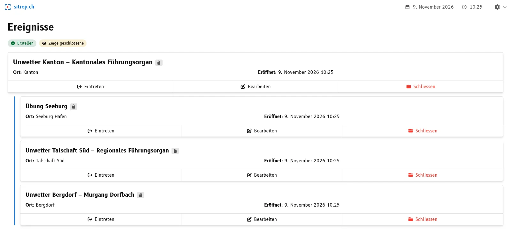
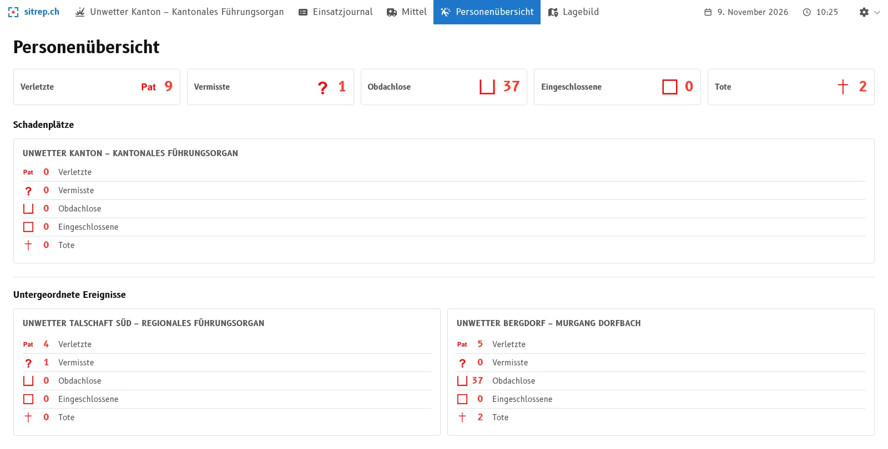

Bei einem Unwetter führen mehrere **Regionale Führungsorgane** (RFO) ihre eigene Lage. Das **Kantonale Führungsorgan** (KFO) braucht das Ganze: Wie viele Verletzte gibt es im Kanton, und welche Mittel sind wo im Einsatz? Mit der Ereignishierarchie beantwortet sitrep das, ohne dass jemand Zahlen sammeln und zusammenzählen muss.

## So funktioniert es

Jedes RFO führt sein eigenes Ereignis in sitrep. Das KFO eröffnet ein **übergeordnetes Ereignis** und ordnet ihm die Ereignisse der Regionen zu: beim Erstellen oder später im Formular über das Feld **Übergeordnetes Ereignis**. In der Ereignisliste stehen die Regionen eingerückt unter dem Kantonalen Führungsorgan.

## Was ein übergeordneter Führungsstab gewinnt

- **Eine Übersicht statt Rückfragen.** Die Personenübersicht des KFO addiert die Zahlen aller Regionen. Darunter stehen sie je Ereignis einzeln.
- **Die Mittel auf einen Blick.** Die Mittelübersicht zeigt die Mittel der Regionen als eigene Gruppen und rechnet sie in die Summen ein.
- **Nichts wird doppelt erfasst.** Die Regionen erfassen ihre Meldungen wie bisher in ihrem Ereignis. Das KFO muss nichts abtippen, und die Zahlen widersprechen sich nicht.

## Was die Regionen behalten

Jedes Ereignis bleibt ein eigenes Ereignis: mit eigenen Meldungen, eigenen Ressorts und eigenem Zugriff. Es wird auch einzeln geschlossen. Das Schliessen des übergeordneten Ereignisses ändert nichts an den Ereignissen der Regionen.

## Gut zu wissen

Es gibt zwei Ebenen: Ein Ereignis ist entweder übergeordnet oder untergeordnet. Als übergeordnetes Ereignis lassen sich nur offene Ereignisse wählen.

## Mehr erfahren

Wie Sie ein Ereignis verknüpfen, steht in der [Anleitung](/docs/user/how-to/ereignis/uebergeordnetes-ereignis-verknuepfen/), den Hintergrund erklärt der Artikel [Übergeordnete und untergeordnete Ereignisse](/docs/user/explanation/ereignis/uebergeordnete-und-untergeordnete-ereignisse/). Ausprobieren können Sie es auf [demo.sitrep.ch](https://demo.sitrep.ch). Fragen nehmen wir gerne unter [info@sitrep.ch](mailto:info@sitrep.ch) entgegen.
